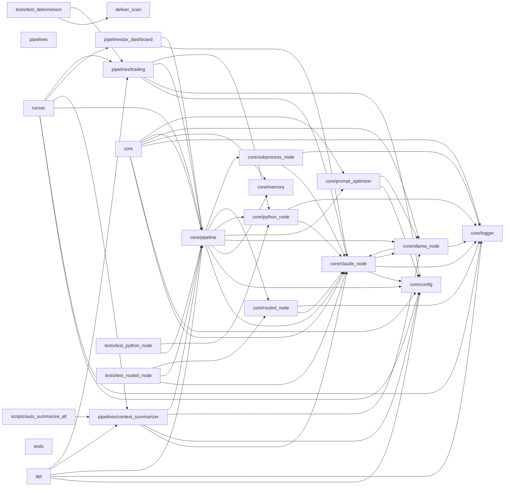

# orchestrator

**Shape:** fastapi &middot; **Signals:** fastapi, python-cli

**Status:** CLAUDE.md found, not phase-structured - carries 2 decisions on file

**Routes:** 0 (0 pages, 0 api)
**Tables:** 0
**Services:** Anthropic (Claude)

_Generated by projmap - do not edit by hand. Full detail: `docs/map/map.json`._

Code structure

| Path | Lang | Fan-in | Fan-out |
|---|---|---|---|
| core/claude_node | py | 10 | 3 |
| core/config | py | 8 | 0 |
| core/logger | py | 8 | 0 |
| core/pipeline | py | 8 | 8 |
| core/ollama_node | py | 5 | 2 |
| core/python_node | py | 3 | 2 |
| pipelines/context_summarizer | py | 3 | 4 |
| pipelines/trading | py | 3 | 4 |
| core/memory | py | 2 | 0 |
| core/prompt_optimizer | py | 2 | 2 |
| core/routed_node | py | 2 | 2 |
| core/subprocess_node | py | 1 | 2 |
| deliver_scan | py | 1 | 0 |
| pipelines/px_dashboard | py | 1 | 2 |
| api | py | 0 | 5 |
| core | py | 0 | 7 |
| pipelines | py | 0 | 0 |
| runner | py | 0 | 6 |
| scripts/auto_summarize_all | py | 0 | 1 |
| tests | py | 0 | 0 |
| tests/test_determinism | py | 0 | 2 |
| tests/test_python_node | py | 0 | 2 |
| tests/test_routed_node | py | 0 | 3 |

Data model

_no tables found_

Routes

_no App Router detected (no `app/` or `src/app/`)_

Process flow

_no key routes found - a route appears here only if its handler (or something it imports) names a known table, either as a string literal or in a SQL `FROM`/`JOIN`/`INTO`/`UPDATE` position_

Design & UI

**Tailwind:** - &middot; **Config:** -

**Fonts:** -

**Components:** 0 found

Services & env

| Service | Via |
|---|---|
| Anthropic (Claude) | dependency, env |

| Env var |
|---|
| `ALPACA_API_KEY` |
| `ALPACA_BASE_URL` |
| `ALPACA_EXECUTE` |
| `ALPACA_SECRET_KEY` |
| `ANTHROPIC_API_KEY` |
| `BOT_SCRIPT` |
| `OLLAMA_BASE_URL` |
| `OLLAMA_FALLBACK_MODEL` |
| `TELEGRAM_BOT_TOKEN` |
| `TELEGRAM_CHAT_ID` |

Build state

**Decisions on file:** 2
- `context/decisions/2026-05-16 - Orchestrator score persistence defers store_memory to after loop.md`
- `context/decisions/2026-05-17 - qwen2.5-coder retained over llama3.2 for Ollama compression.md`

**TODO/FIXME markers:** 0

Cross-project

_cross-project aggregation lives in the portfolio map: `docs/map/PORTFOLIO.md` at the monorepo root_

